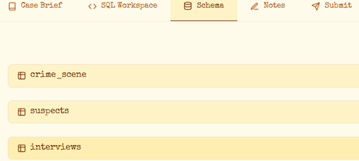
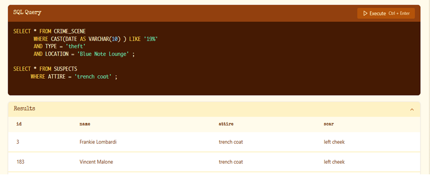
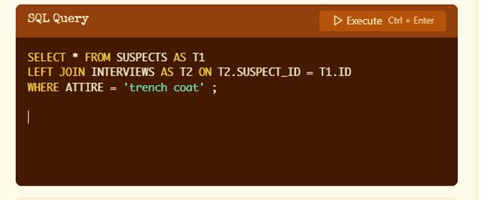

# SQL-Mystery-Investigation
A practical SQL repository documenting case studies, queries, analysis, debugging, and solutions while strengthening analytical thinking and problem-solving skills.

### Case #001: The Vanishing Briefcase (SQLNoir:https://www.sqlnoir.com/cases)

A briefcase was stolen from the Blue Note Lounge. A witness saw a man in a trench coat fleeing. Find the clues, match the suspect, and verify the culprit through interviews.

👣 Investigating the Crime Sceene
I filtered crime scene records by date, crime type, and location to retrieve the relevant incident and uncover the key clue.
And Using witness description, I filtered suspects wearing a trench coat.

👣 Verifying through Interviews
To connect suspect profiles with their interview records, I used a LEFT JOIN on the suspect IDs.

I compared the matching profiles and interview transcripts to identify the suspect supported by the evidence.

👣 Final Verdict Culprit : Vincent Malone - the crime scene due, matching suspect profile, and interview transcript confirmed Vincent Malone as the culprit.

Key : This case Strengthened my ability to investigate data systematically, narrow down possibilities using filters, connect related tables, and verfy conclusions using evidence rather than assumptions.

#### SQL :  SELECT · WHERE · CAST · LIKE · AND · LEFT JOIN 

